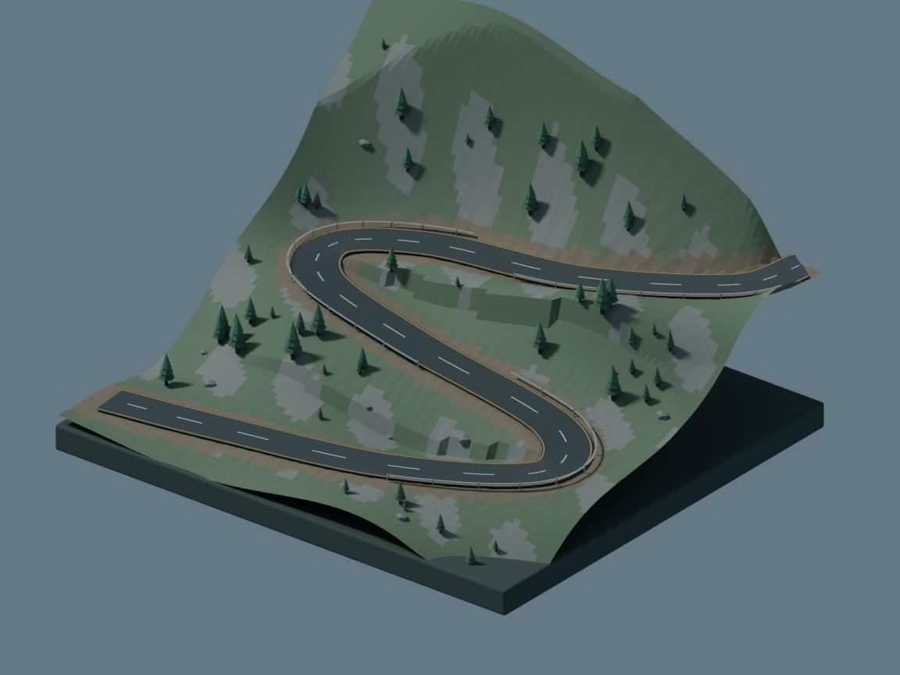

# Switchback Scene

An editable Blender diorama of a two-lane alpine pass with procedural terrain, pine stands, gravel shoulders, road markings and guardrails. The project includes the native scene and the script that produced it.



Open `switchback.blend` in Blender. Use the overview camera for the composed view. Objects and materials are named by their function, so the road, terrain, vegetation, and trim can be edited separately.

```sh
blender --background --python build_scene.py -- --output switchback.blend --render preview.png
```

The script uses Blender's bundled Python and copies no external meshes or textures. Use `--seed` to change vegetation placement. The editable route control points are in `build_scene.py`. Road geometry is generated from a Catmull–Rom spline and separate material strips. The terrain slopes toward the centerline profile around each road section.
